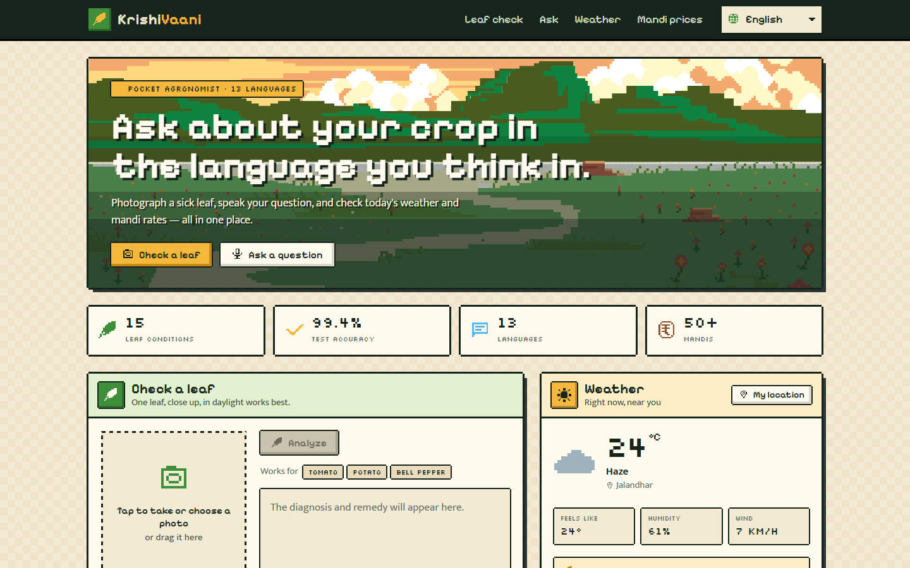
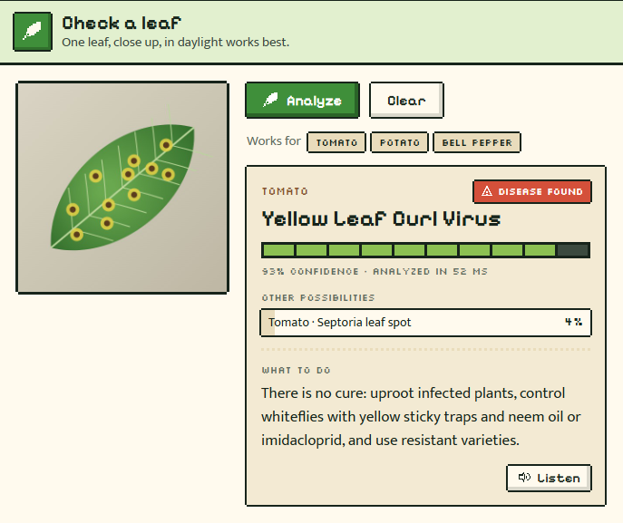
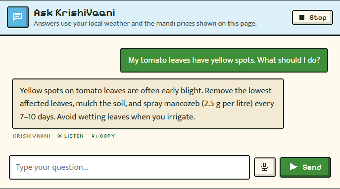
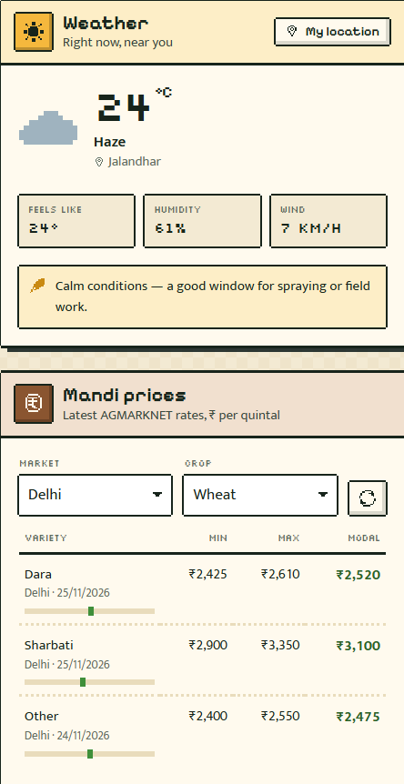
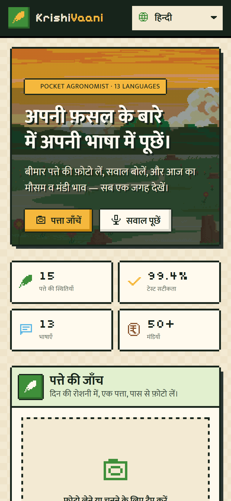
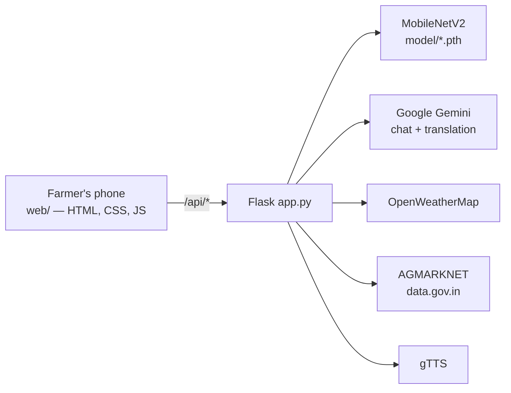

<div align="center">


# KrishiVaani AI

**A pocket agronomist for Indian farmers — in their own language.**

Photograph a sick leaf, ask a question by voice, and check today's weather and mandi prices,
in any of 13 Indian languages.

[](https://github.com/Ankit-Basu/KrishiVaaniAI/actions/workflows/ci.yml)
[](LICENSE)


[Screenshots](#screenshots) · [Deploy for free](DEPLOY.md) · [Report a bug](https://github.com/Ankit-Basu/KrishiVaaniAI/issues)

</div>



---

## The problem

Indian farmers lose crops to disease, guess at the weather, and sell without knowing the going rate.
Most advisory apps are English-first, heavy on data, or ignore local context.

## What KrishiVaani does

| | Feature | How |
|---|---|---|
| 🍃 | **Leaf check** — snap a leaf, get the disease and what to do | MobileNetV2 fine-tuned on PlantVillage, ~50 ms per photo on CPU; shows the top 3 guesses and warns when it isn't sure |
| 💬 | **Ask anything** — by typing or speaking, with follow-up questions | Google Gemini, with your local weather, mandi prices and the last few turns as context |
| 🗣️ | **Hear the answer** | Browser speech, with a gTTS fallback on the server |
| 🌦️ | **Weather near you** — plus a spray/irrigation tip | OpenWeatherMap + browser geolocation |
| 💰 | **Mandi prices** — min / max / modal ₹ per quintal | AGMARKNET via data.gov.in, 50+ markets, 70+ crops |
| 🌐 | **13 languages** | English, हिन्दी, বাংলা, தமிழ், తెలుగు, मराठी, ગુજરાતી, ಕನ್ನಡ, മലയാളം, ਪੰਜਾਬੀ, اردو, ଓଡ଼ିଆ, অসমীয়া |
| 📲 | **Installable, works offline** | PWA manifest + service worker: the app opens with no signal and shows an offline banner |

The UI is a pixel-art interface built with plain HTML/CSS/JS (no build step): pixel fonts and hand-drawn 12×12 pixel icons for the chrome, a readable body font that covers every Indic script, mobile-first layout, and it remembers the farmer's language. Phone photos are shrunk in the browser before upload, so checks stay quick on slow connections.

## Engineering notes

- **One deployable.** Flask serves the static site and the API, so one Docker image runs everything (Hugging Face Spaces, free).
- **Fast and frugal.** CPU-only PyTorch; weather cached 10 min per ~1 km cell, mandi prices 30 min, translated remedies 24 h. This cuts latency and keeps free API quotas intact.
- **Abuse protection.** Per-IP rate limit on the Gemini-backed endpoints (`RATE_LIMIT_PER_MIN`), input length caps, a 16 MB upload limit, language codes validated against an allow-list.
- **Safe by default.** The static route can't serve `.env` or source files. Errors never echo upstream exceptions (they can contain API keys), and `/healthz` reports only *whether* keys are set.
- **Honest ML.** Below 60% confidence the UI says "Not sure", explains why and shows the alternatives instead of guessing.
- **Tested.** 22 pytest tests with all external APIs mocked; GitHub Actions runs them, then builds the Docker image and checks `/healthz`.

## Screenshots

| Leaf check | Ask KrishiVaani |
|---|---|
|  |  |

| Weather and mandi prices | Mobile, in Hindi |
|---|---|
|  |  |

<sub>Screenshots use sample weather, mandi and chat data.</sub>

## How it works



One Flask process serves both the website and the API, so a single deploy is enough.

## Project structure

```
KrishiVaaniAI/
├── app.py                 # Flask server: serves web/ and the /api/* endpoints
├── model/
│   ├── mobilenetv2_leaf_disease_final.pth   # trained weights (9 MB)
│   └── index_to_name.json                   # class index → label
├── docs/screenshots/      # images used in this README
├── web/                   # the website (static, no build step)
│   ├── index.html
│   ├── main.js            # UI logic, i18n, voice, API calls
│   ├── sw.js              # service worker: offline shell, never caches /api
│   ├── manifest.webmanifest
│   ├── css/style.css
│   └── images/            # hero art, app icons, social preview
├── tests/test_app.py      # pytest suite, external APIs mocked
├── .github/workflows/ci.yml  # tests + Docker build on every push
├── training/
│   ├── train_mobilenetv2_leaf_disease.ipynb
│   └── split_train_val.py # 80/20 train/val split helper
├── scripts/
│   └── smoke_test.py      # checks a running server end to end
├── requirements.txt       # includes CPU-only PyTorch
├── requirements-dev.txt   # + pytest
├── Dockerfile             # Hugging Face Spaces / any Docker host
├── render.yaml            # Render blueprint
├── netlify.toml           # Netlify: static site + /api proxy
├── vercel.json            # Vercel: static site + /api proxy
├── .env.example
└── DEPLOY.md              # free hosting guide
```

## Run it locally

You need Python 3.11 and three free API keys (see [DEPLOY.md](DEPLOY.md#0-get-the-free-api-keys)).

```bash
git clone https://github.com/Ankit-Basu/KrishiVaaniAI.git
cd KrishiVaaniAI
python -m venv venv
venv\Scripts\activate            # macOS/Linux: source venv/bin/activate
pip install -r requirements.txt
copy .env.example .env           # macOS/Linux: cp .env.example .env — then add your keys
python app.py
```

Open http://localhost:5000. To check every endpoint at once:

```bash
python scripts/smoke_test.py http://localhost:5000 path/to/leaf.jpg
```

Run the test suite (no API keys or network needed):

```bash
pip install -r requirements-dev.txt
python -m pytest -q
```

### Environment variables

| Name | Required | Purpose |
|---|---|---|
| `GEMINI_API_KEY` | yes | Chat answers and translated remedies |
| `OPENWEATHER_API_KEY` | yes | Weather card and chat context |
| `MANDI_API_KEY` | yes | Mandi prices (data.gov.in) |
| `GEMINI_MODEL` | no | Defaults to `gemini-2.5-flash` |
| `PORT` | no | Defaults to `5000` |
| `FLASK_DEBUG` | no | Set to `1` for auto-reload while developing |
| `RATE_LIMIT_PER_MIN` | no | Requests per minute per IP for analyze/chat/tts. Defaults to `30`; `0` turns it off |

## API

| Method | Path | Body / query | Returns |
|---|---|---|---|
| `POST` | `/api/analyze` | form-data `image`, `lang` | `class`, `confidence`, `confident`, `top[3]`, `remedy`, `inference_ms` |
| `POST` | `/api/chat` | JSON `query`, `lang`, `lat`, `lon`, `mandi`, `history[]` | `reply` |
| `GET` | `/api/weather` | `lat`&`lon` or `city` | `temp`, `description`, `humidity`, `wind_kmh`, … |
| `GET` | `/api/mandi` | `market`, `commodity` | `records[]` with min/max/modal price |
| `POST` | `/api/tts` | JSON `text`, `lang` | `audio` (base64 MP3) |
| `GET` | `/healthz` | — | `ok`, model info, which keys are `configured` (booleans) |

Analyze, chat and TTS return `429` when the per-IP rate limit is hit.

## Deploy for free

Short version: push this repo to a **Hugging Face Space (Docker)**, add the three keys as secrets, done.
Optionally put the front-end on **Vercel** or **Netlify** and point `/api` at the Space.
Full steps: **[DEPLOY.md](DEPLOY.md)**.

## The model

MobileNetV2 fine-tuned on a 15-class subset of the PlantVillage dataset (pepper, potato, tomato).
Training notebook: [training/train_mobilenetv2_leaf_disease.ipynb](training/train_mobilenetv2_leaf_disease.ipynb).

| | |
|---|---|
| Input | 224 × 224 RGB |
| Training | 5 epochs, batch 32, Adam (lr 1e-4) |
| Test accuracy | **99.44%** on 4,134 images |
| Macro precision / recall / F1 | 99.51% / 99.48% / 99.49% |
| Size / speed | 9.2 MB, ~50 ms per image on a laptop CPU |

<details>
<summary>Per-class results</summary>

| Class | Precision | Recall | F1 | Samples |
|---|---|---|---|---|
| Pepper — Bacterial spot | 1.0000 | 1.0000 | 1.0000 | 200 |
| Pepper — Healthy | 1.0000 | 1.0000 | 1.0000 | 296 |
| Potato — Early blight | 1.0000 | 0.9950 | 0.9975 | 200 |
| Potato — Late blight | 1.0000 | 0.9950 | 0.9975 | 200 |
| Potato — Healthy | 1.0000 | 1.0000 | 1.0000 | 31 |
| Tomato — Bacterial spot | 0.9953 | 0.9883 | 0.9918 | 426 |
| Tomato — Early blight | 0.9800 | 0.9800 | 0.9800 | 200 |
| Tomato — Late blight | 0.9845 | 0.9974 | 0.9909 | 382 |
| Tomato — Leaf Mold | 1.0000 | 0.9895 | 0.9947 | 191 |
| Tomato — Septoria leaf spot | 0.9916 | 1.0000 | 0.9958 | 355 |
| Tomato — Spider mites | 0.9853 | 0.9940 | 0.9896 | 336 |
| Tomato — Target Spot | 0.9929 | 0.9893 | 0.9911 | 281 |
| Tomato — Yellow Leaf Curl Virus | 1.0000 | 0.9938 | 0.9969 | 642 |
| Tomato — Mosaic Virus | 1.0000 | 1.0000 | 1.0000 | 75 |
| Tomato — Healthy | 0.9969 | 1.0000 | 0.9984 | 319 |

</details>

PlantVillage photos are taken on plain backgrounds, so accuracy on real field photos will be lower.
Photos of a single leaf, close up, in daylight work best.

## Roadmap

- [x] Installable PWA with offline app shell
- [ ] Queue leaf checks taken offline and run them when back online
- [ ] More crops (rice, wheat, cotton) trained on field photos
- [ ] Multi-day forecast and rainfall alerts
- [ ] WhatsApp / SMS bot for feature phones
- [ ] Community Q&A and remedy ratings

## Contributing

Pull requests are welcome. For larger changes, open an issue first to discuss what you'd like to change.
Run `python -m pytest -q` (and `python scripts/smoke_test.py` against your local server) before submitting.

## Credits

- Built by **Ankan Basu** and **Ankit Basu**, Lovely Professional University
- Dataset: [PlantVillage](https://www.kaggle.com/datasets/emmarex/plantdisease)
- Data: OpenWeatherMap, AGMARKNET (data.gov.in), Google Gemini

## License

[MIT](LICENSE) © 2025 Ankan Basu, Ankit Basu
